# User flow — Andrejevici

Traced from the implementation: [src/app](src/app), [src/stores](src/stores), [src/helpers](src/helpers)
and the three Cloud Function packages. Each diagram is Mermaid source, so it can be pasted into
GitHub, a Mermaid live editor, or an IDE preview. Rendered PNG copies live in [docs/images](docs/images).

- [1. App boot, auth and route gating](#1-app-boot-auth-and-route-gating)
- [2. Photo upload and publish](#2-photo-upload-and-publish)
- [3. Browse, search and filter](#3-browse-search-and-filter)
- [4. Link a YouTube video](#4-link-a-youtube-video)
- [5. Swap an image](#5-swap-an-image)
- [6. Delete a record](#6-delete-a-record)
- [7. Admin · repair](#7-admin--repair)
- [8. Admin · metadata values](#8-admin--metadata-values)
- [9. Admin · users, roles and sessions](#9-admin--users-roles-and-sessions)

---

## 1. App boot, auth and route gating

`AppInitializer` runs on every page: it resets UI state, loads `Bucket/total` and the `Counter`
documents, observes Firebase Auth, subscribes to the latest record, and only when the page is idle
imports Firebase Messaging and registers `/sw.js`. Route protection is client-side: `/add` and
`/admin` render `null` and `router.replace('/401')` until the store says otherwise.

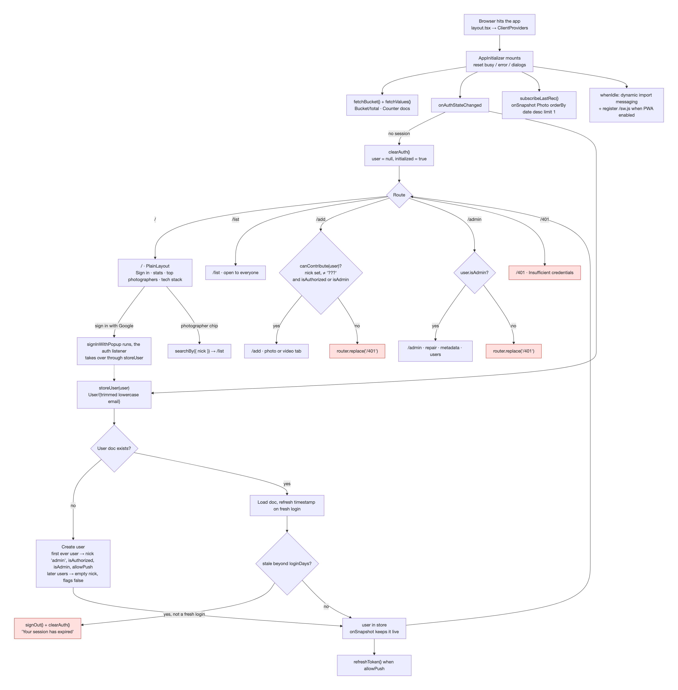

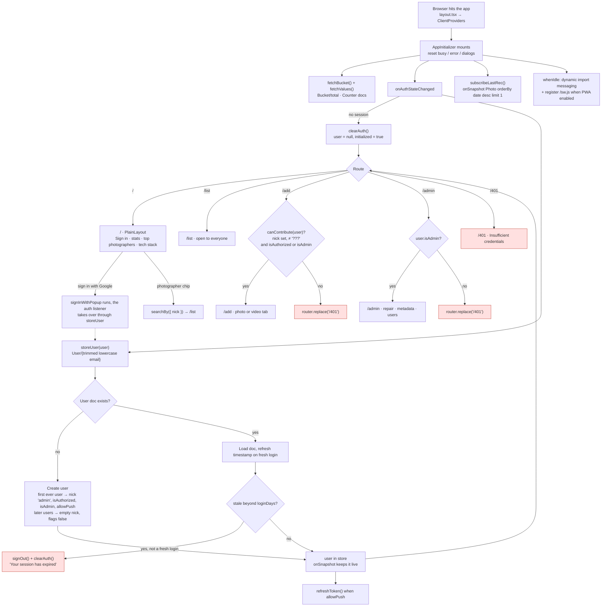

## 2. Photo upload and publish

Upload and publish are two separate phases. The upload writes bytes to Cloud Storage and appends a
partial record to `store.uploaded`; the publish writes the `Photo` document, and only that document
makes the image appear in the gallery. A record with no `thumb` is by definition unpublished — that
is the flag `saveRecord` branches on. Thumbnail bytes are always the server's job: the
`generateThumbnailOnUpload` Storage trigger fires the moment an original lands. The client builds a
thumbnail too, but only for display: each finished upload is cropped into a `CONFIG.thumbSize`
square whose `blob:` URL the queue card and the `EditPhotoRecord` dialog paint, so editing a
just-uploaded photo never downloads or decodes the full-resolution original. That crop is never
uploaded — it would race the trigger for the same object — and the server URL replaces it on the
record as soon as the record is published.

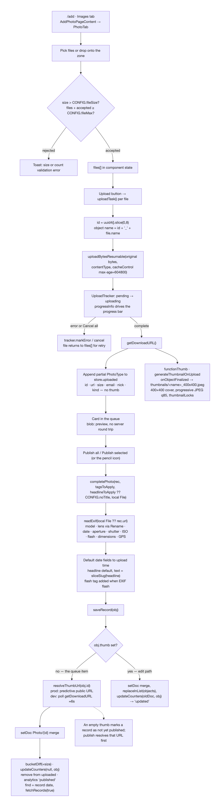

```mermaid
flowchart TD
    A["/add · Images tab<br/>AddPhotoPageContent → PhotoTab"] --> B["Pick files or drop onto the zone"]
    B --> C{"size > CONFIG.fileSize?<br/>files + accepted ≥ CONFIG.fileMax?"}
    C -->|rejected| D["Toast: size or count validation error"]
    C -->|accepted| E["files[] in component state"]
    E --> F["Upload button → uploadTask() per file"]
    F --> G["id = uuid4().slice(0,8)<br/>object name = id + '_' + file.name"]
    G --> H["uploadBytesResumable(original bytes,<br/>contentType, cacheControl max-age=604800)"]
    H --> I["transferStore.startTransfer(file, 'upload')<br/>UploadTracker: pending → uploading<br/>one shared 100ms ProgressThrottle"]
    I -->|error| J["tracker.fail<br/>file returns to files[] for retry"]
    I -->|Cancel all (kind-scoped)| J2["tracker.cancel<br/>requeued silently, no toast"]
    I -->|complete| K["getDownloadURL()"]
    K --> L["Append partial PhotoType to store.uploaded<br/>id · url · size · email · nick · kind — no thumb"]
    K --> M["functionThumb · generateThumbnailOnUpload<br/>onObjectFinalized → thumbnails/&lt;name&gt;_400x400.jpeg<br/>400×400 cover, progressive JPEG q85, thumbnailLocks"]
    L --> N["Card in the queue<br/>blob: preview, no server round trip"]

    N --> O["Publish all / Publish selected (or the pencil icon)"]
    O --> P["completePhoto(rec, tagsToApply, headlineToApply ?? CONFIG.noTitle, local File)"]
    P --> Q["readExif(local File ?? rec.url)<br/>model · lens via Rename · date · aperture · shutter · ISO · flash · dimensions · GPS"]
    Q --> R["Default date fields to upload time<br/>headline default, text = sliceSlug(headline)<br/>flash tag added when EXIF flash"]
    R --> S["saveRecord(obj)"]
    S --> T{"obj.thumb set?"}
    T -->|no — the queue item| U["resolveThumbUrl(obj.id)<br/>prod: predictive public URL<br/>dev: poll getDownloadURL ≈6s"]
    U --> V["setDoc Photo/{id} merge"]
    V --> W["bucketDiff(+size) · updateCounters(null, obj)<br/>remove from uploaded · analytics 'published'<br/>find = record date, fetchRecords(true)"]
    T -->|yes — edit path| X["setDoc merge, replaceInList(objects),<br/>updateCounters(oldDoc, obj) → 'updated'"]

    N2["An empty thumb marks a record as not yet published;<br/>publish resolves that URL first"]
    U -.-> N2
```

## 3. Browse, search and filter

`/list` is public. Every filter change resets the query, and `fetchRecords` cursor-pages with
`startAfter`. `error === 'empty'` means the query is exhausted, not that a page came back short, so
the infinite-scroll observer keeps loading while pages remain.

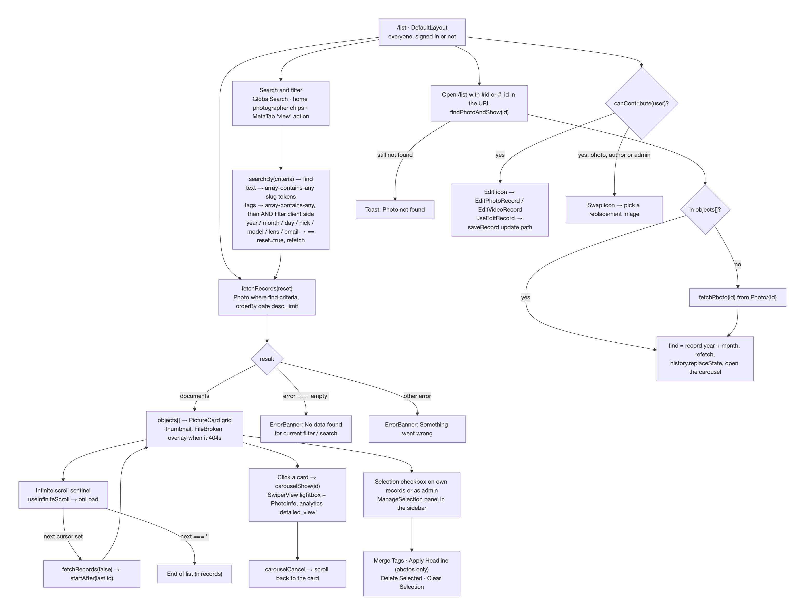

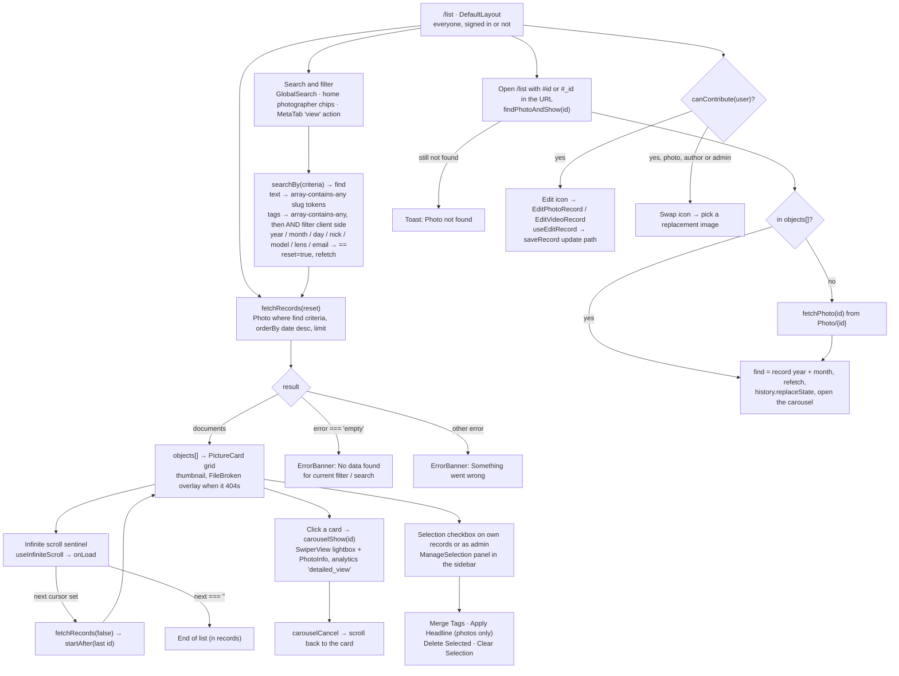

## 4. Link a YouTube video

The video flow is publish-only: nothing is uploaded, `size` is `0`, and the thumbnail is derived
from the YouTube id. `saveVideo` deliberately leaves `Bucket/total` alone.

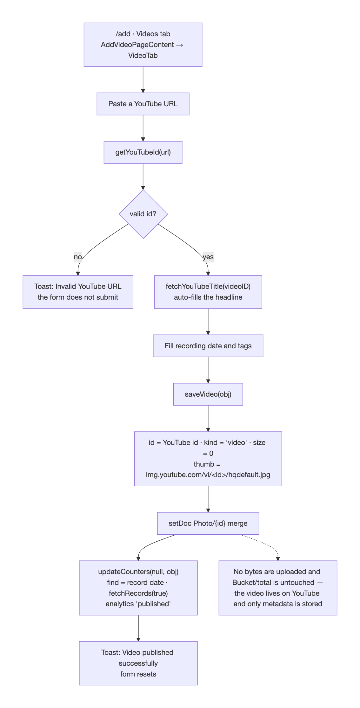

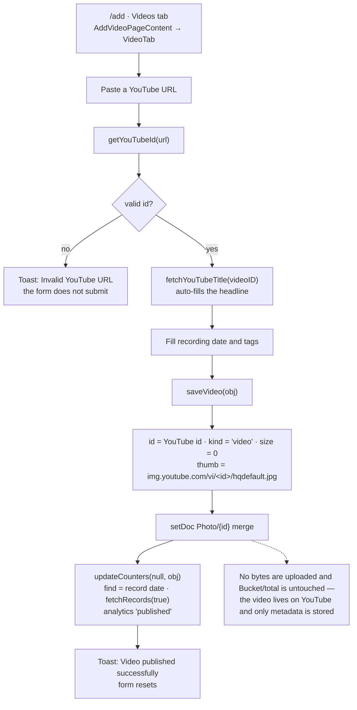

## 5. Swap an image

The only flow that uploads and publishes together. It is gated by `isAuthorOrAdmin`, uploads the new
bytes under a new id, writes the new document, deletes the old document and the old Storage objects,
and republishes. The client crops the new local `File` into a `blob:` thumbnail purely so the card
paints immediately; `saveRecord` resolves the canonical URL if it ever sees one, so a preview can
never reach Firestore.

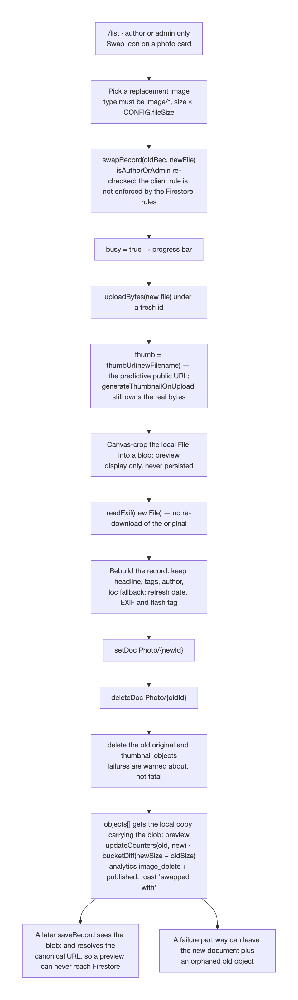

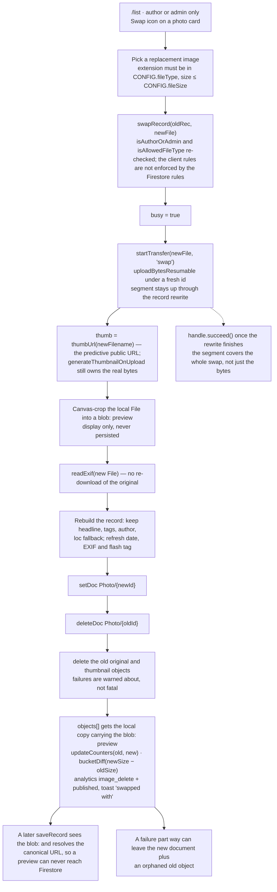

## 6. Delete a record

Deletion removes the `Photo` document plus the original and the `thumbnails/` object, then reverses
the counters and the bucket total. A Storage object that is already gone is tolerated, so deleting a
queued item — or a record whose thumbnail never materialized — does not error.

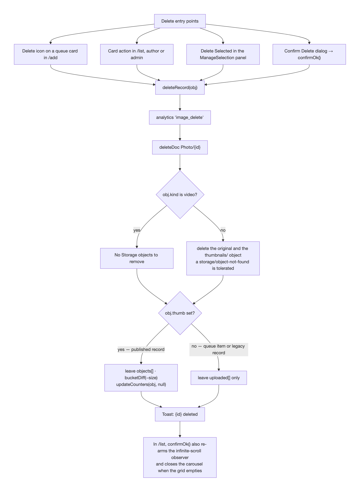

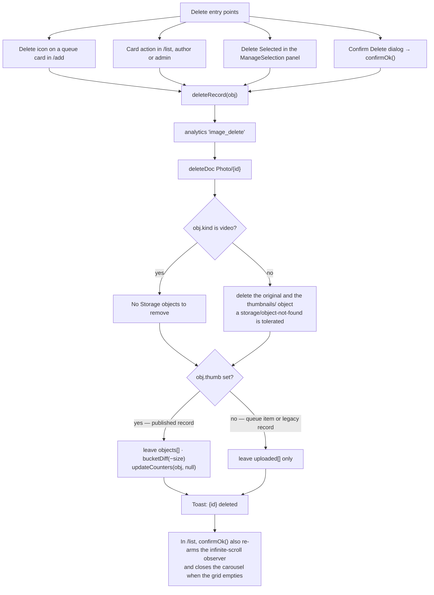

## 7. Admin · repair

The Repair tab is build/repair tooling: bucket totals, metadata counters, missing thumbnails and
Storage↔Firestore mismatch. Both the bucket total and the counters are also rebuilt by `functionCron`
every three days, so these buttons are the on-demand version of the same work.

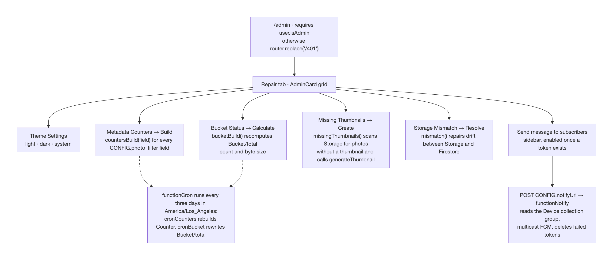

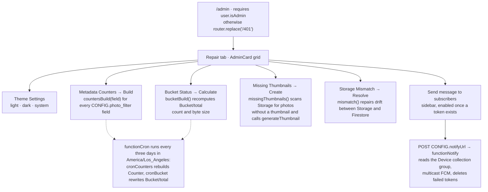

## 8. Admin · metadata values

Metadata values are `Counter` documents. Renaming or deleting a value rewrites the matching `Photo`
documents in batches and then rebuilds that field's counters. `flash` and `CONFIG.unknownModel` are
protected.

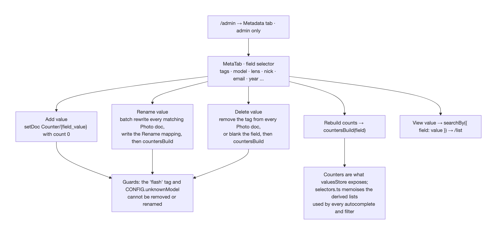

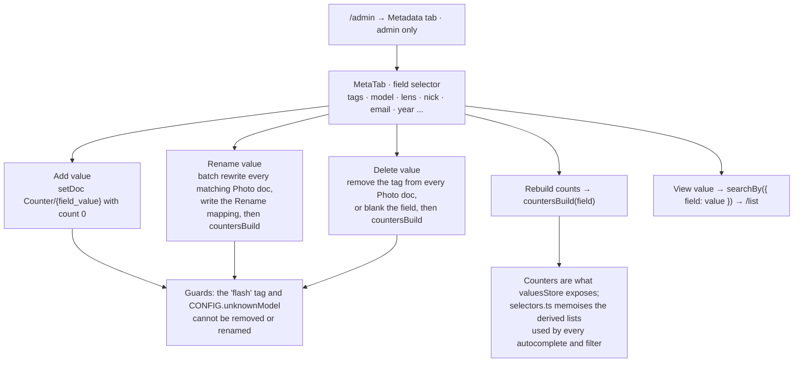

## 9. Admin · users, roles and sessions

An administrator assigns nicknames and flips `isAuthorized`, `isAdmin` and `allowPush`. Because
`AppInitializer` holds an `onSnapshot` on the signed-in `User` document, those changes reach a live
client without a reload — and a user document that disappears or goes stale (`timestamp` beyond
`CONFIG.loginDays`, or set to `0` by Log out) signs that client out.

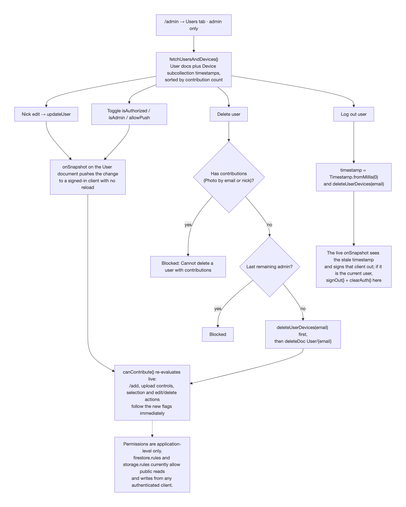

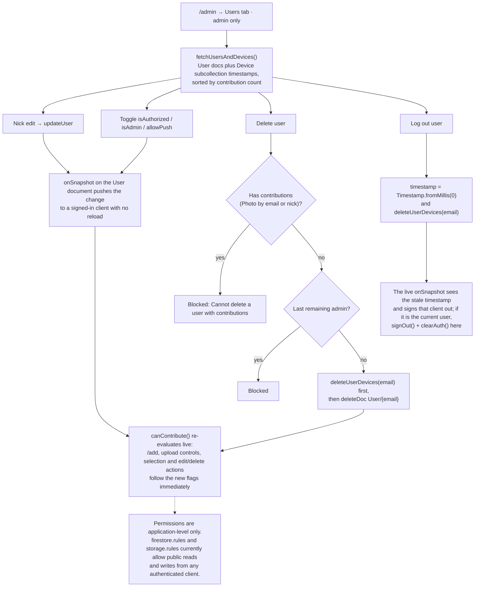

---

## Routes

| Route    | Component                                                              | Layout          | Access                                                            |
| -------- | ---------------------------------------------------------------------- | --------------- | ----------------------------------------------------------------- |
| `/`      | [HomePageContent.tsx](src/app/HomePageContent.tsx)                     | `PlainLayout`   | Public — sign in, counters, photographer chips, tech-stack dialog |
| `/list`  | [ListPageContent.tsx](src/app/list/ListPageContent.tsx)                | `DefaultLayout` | Public — gallery, search, infinite scroll, carousel, selection    |
| `/add`   | [AddPageContent.tsx](src/app/add/AddPageContent.tsx)                   | `DefaultLayout` | `canContribute()` — otherwise `/401`                              |
| `/admin` | [AdminPageContent.tsx](src/app/admin/AdminPageContent.tsx)             | `DefaultLayout` | `user.isAdmin` — otherwise `/401`                                 |
| `/401`   | [UnauthorizedPageContent.tsx](src/app/401/UnauthorizedPageContent.tsx) | `PlainLayout`   | Public — "Insufficient credentials"                               |
| —        | [NotFoundPageContent.tsx](src/app/NotFoundPageContent.tsx)             | —               | Unknown paths                                                     |

The sidebar shows Add only for contributors and Admin only for admins. It also mounts
`ManageSelection` on `/list` and `SendMessage` on `/add` and `/admin`. The toolbar switches on the
path: `ListToolbar`, `AddToolbar`, `AdminToolbar`.

## Access tiers

| Tier                     | Check                        | Unlocks                                                                |
| ------------------------ | ---------------------------- | ---------------------------------------------------------------------- |
| Anonymous or any session | —                            | `/`, `/list`, `/401`, reads of `Photo`, `Counter`, `Bucket`            |
| Signed in                | `user !== null`              | Own `User` document, FCM token when `allowPush`                        |
| Contributor              | `canContribute(user)`        | `/add` upload and publish, selection tools, edit/delete own records    |
| Author or admin          | `isAuthorOrAdmin(user, rec)` | Edit, swap and delete that specific record                             |
| Admin                    | `user.isAdmin`               | `/admin` (repair, metadata, users), batch select on any record, notify |

`canContribute()` requires a signed-in user with a non-empty nickname that is not `???` and either
`isAuthorized` or `isAdmin`. These are application-level gates: `firestore.rules` and
`storage.rules` currently allow public reads and writes from any authenticated client, so the client
checks gate the UI, not the data.

## What each flow writes

| Flow            | Firestore                                                  | Storage                                                      | Counters / bucket                        |
| --------------- | ---------------------------------------------------------- | ------------------------------------------------------------ | ---------------------------------------- |
| Photo upload    | —                                                          | original at `uuid8_filename`                                 | none                                     |
| Photo publish   | `Photo/{id}` (merge)                                       | — (the thumbnail trigger writes `thumbnails/…_400x400.jpeg`) | `Bucket/total` +size, `Counter` +1 each  |
| Photo edit      | `Photo/{id}` (merge)                                       | —                                                            | `Counter` diff old → new                 |
| Video link      | `Photo/{youtubeId}` (merge)                                | —                                                            | `Counter` +1 each; bucket untouched      |
| Swap            | `Photo/{newId}` set, `Photo/{oldId}` deleted               | new original uploaded, old original + thumbnail deleted      | `Counter` diff, `Bucket/total` size diff |
| Delete          | `Photo/{id}` deleted                                       | original + thumbnail deleted (missing tolerated)             | `Counter` −1 each, `Bucket/total` −size  |
| Metadata rename | matching `Photo` docs + `Counter` rebuilt                  | —                                                            | `Counter` rebuilt for that field         |
| Metadata delete | tag stripped / field blanked in `Photo`, `Counter` rebuilt | —                                                            | `Counter` rebuilt for that field         |
| User change     | `User/{email}`, `User/{email}/Device`                      | —                                                            | —                                        |

## Deliberate behaviours worth knowing

- **Uploaded is not published.** Bytes in Storage with no `Photo` document are invisible; abandoning
  the queue leaves an orphaned Storage object.
- **The thumbnail race is resolved by ownership, not by waiting.** The client never uploads a
  thumbnail for a normal upload; the crop it makes on upload completion is display-only, so it
  cannot contend with the trigger for the `thumbnails/` object. Production stores the predictive
  public URL; development polls `getDownloadURL` for about six seconds because the emulator serves
  objects behind a token.
- **A `blob:` thumbnail is display-only.** On the upload queue (card and edit dialog) and after a
  swap it lives in component state; both `saveRecord` and `swapRecord` resolve the server URL, so a
  preview cannot be persisted.
- **Publishing moves the gallery.** `saveRecord` and `saveVideo` set `find` to the record's date and
  refetch, so the new item is visible immediately.
- **Selection is per-record.** The checkbox on a card appears only for your own records or for an
  admin, and the batch actions reuse `saveRecord` / `deleteRecord`.
- **Permissions propagate live.** `onSnapshot` on `User/{email}` means a revoke, a role flip or a
  forced logout takes effect on the open page without a refresh.
- **Admin user deletion is guarded twice.** A user with contributions cannot be deleted, and the last
  remaining admin cannot be deleted.
- **Sessions expire.** User timestamps are compared against `CONFIG.loginDays` (60 days); a stale
  document signs the client out, and the push-consent dialog appears on the return visit when
  `allowPush` is still false.

## Firebase paths touched by these flows

`User` (keyed by the trimmed, lowercased email), `User/{email}/Device`, `Photo`, `Counter`, `Bucket`
(including `Bucket/total`), `Rename`, `LastRecord`, plus the function-owned `thumbnailLocks`
collection. Collection references come from
[src/helpers/collections.ts](src/helpers/collections.ts) — keep them in sync with
[functionThumb](functionThumb/index.ts), the indexes and the deployed rules when a path changes.
